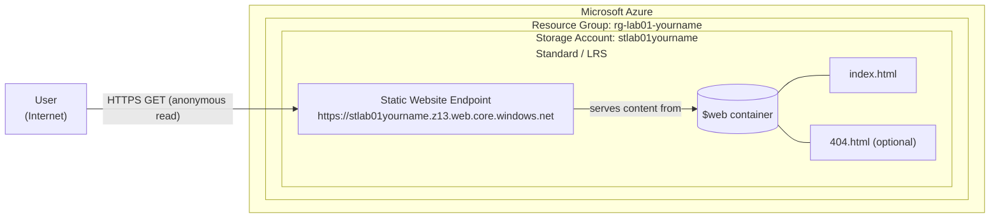
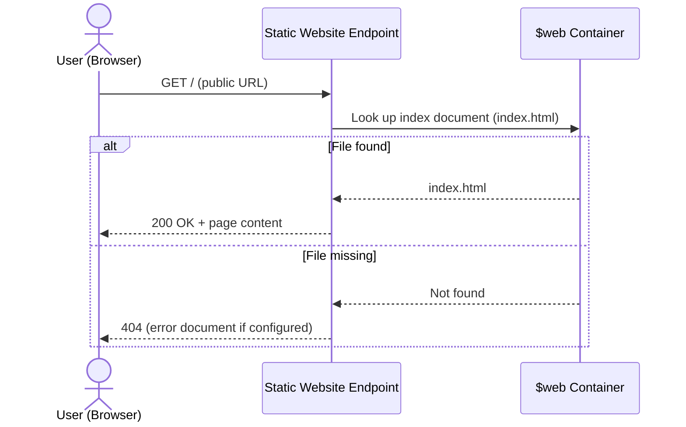

# Hosting a Static Website on Azure Blob Storage


## [🎬 Watch Me Build This Lab!](https://streamable.com/6xxa4r)

---

## Table of Contents

1. [Overview](#1-overview)
2. [Architecture](#2-architecture)
3. [Prerequisites](#3-prerequisites)
4. [Lab Variables](#4-lab-variables)
5. [Step-by-Step Instructions](#5-step-by-step-instructions)
6. [Validation](#6-validation)
7. [Security Considerations](#7-security-considerations)
8. [Troubleshooting](#8-troubleshooting)
9. [Clean Up](#9-clean-up)
10. [Optional: Azure CLI Equivalent](#10-optional-azure-cli-equivalent)
11. [Key Takeaways](#11-key-takeaways)

---

## 1. Overview

This lab deploys a first public-facing resource in Azure: a static website hosted entirely on **Azure Blob Storage**. There is no web server to build, patch, or harden. Azure runs the infrastructure and I only manage the content.

**What this lab demonstrates**

- Hosting a website with **PaaS / serverless** services instead of a VM
- Creating and organizing resources with a **resource group** and a consistent **naming convention**
- Enabling the **static website** feature on a storage account
- Uploading content to the `$web` container and validating the public endpoint
- Understanding what is exposed to the internet, and why that matters

**Services used:** Azure Resource Group, Azure Storage Account (Blob Storage, static website hosting)

---

## 2. Architecture

### 2.1 Component View



### 2.2 Request Flow



### 2.3 Trust Boundary Summary

| Zone | What lives here | Exposure |
|------|-----------------|----------|
| Internet | End users and browsers | Untrusted |
| Static website endpoint (`*.web.core.windows.net`) | Public read-only entry point | **Public by design** |
| `$web` container | Website files only | Served through the endpoint |
| Azure Portal / management plane | Where I configure and upload | Authenticated with Microsoft Entra ID |

---

## 3. Prerequisites

- [ ] Active Azure subscription (Free Tier is fine)
- [ ] Completed Week 1 video modules
- [ ] A basic text editor (Notepad, TextEdit, or VS Code)

---

## 4. Lab Variables

Use a consistent naming convention so resources are easy to find, audit, and delete.

| Item | Value |
|------|-------|
| Resource group | `rg-lab01-[yourname]` |
| Location | `East US` |
| Storage account | `stlab01[yourname]` |

> **Naming rule:** storage account names must be **globally unique**, **all lowercase**, letters and numbers only, 3 to 24 characters.

---

## 5. Step-by-Step Instructions

### Phase 1: Create the Resource Group

1. Sign in to the [Azure Portal](https://portal.azure.com).
2. Search for **Resource groups** in the top search bar.
3. Click **+ Create**.
4. On the **Basics** tab:
   - **Subscription:** select your subscription
   - **Resource group:** `rg-lab01-[yourname]`
   - **Region:** `(US) East US`
5. Click **Review + create**, then **Create**.

**Expected result:** the resource group appears in your resource group list.

### Phase 2: Create the Storage Account

1. Search for **Storage accounts** and click **+ Create**.
2. On the **Basics** tab:
   - **Resource group:** `rg-lab01-[yourname]`
   - **Storage account name:** `stlab01[yourname]` (for example, `stlab01jhante`)
   - **Region:** `(US) East US`
   - **Performance:** Standard
   - **Redundancy:** Locally-redundant storage (LRS). This is the cheapest option and is fine for a lab.
3. Click **Review + create** and wait for validation to pass.
4. Click **Create**. Deployment takes about 30 seconds.
5. Click **Go to resource**.

**Expected result:** the storage account overview page loads inside your resource group.

### Phase 3: Enable Static Website Hosting

1. In the storage account's left-hand menu, under **Data management**, click **Static website**.
2. Set **Static website** to **Enabled**.
3. **Index document name:** `index.html`
4. **Error document path:** `404.html` (optional, but good practice)
5. Click **Save**.
6. Copy the **Primary endpoint** URL that appears, for example:
   `https://stlab01jhante.z13.web.core.windows.net/`

**Expected result:** a primary endpoint URL is displayed. This is your website's address.

> Enabling this feature automatically creates a container named **`$web`**.

### Phase 4: Create the Website Files

1. Open your text editor and paste the following:

```html
<!DOCTYPE html>
<html>
<head>
    <title>My First Cloud Site</title>
    <style>
        body { font-family: sans-serif; text-align: center; margin-top: 50px; background-color: #f0f0f0; }
        h1 { color: #0078d4; }
    </style>
</head>
<body>
    <h1>Hello from the Cloud!</h1>
    <p>This site is hosted on Azure Blob Storage.</p>
    <p>Deployed by: [Your Name]</p>
</body>
</html>
```

2. Save it as **`index.html`**.

3. *(Optional)* Create a simple `404.html` so the error document you configured actually exists:

```html
<!DOCTYPE html>
<html>
<head><title>Page Not Found</title></head>
<body style="font-family: sans-serif; text-align: center; margin-top: 50px;">
    <h1>404: Page Not Found</h1>
    <p>The page you requested does not exist.</p>
</body>
</html>
```

### Phase 5: Upload Content

1. In the portal, open your storage account and select **Containers** (under **Data storage**).
2. Open the **`$web`** container (created automatically in Phase 3).
3. Click **Upload**.
4. Browse to `index.html` (and `404.html` if you created it) and click **Upload**.

**Expected result:** the files are listed inside the `$web` container.

---

## 6. Validation

1. Open a new browser tab.
2. Paste the **Primary endpoint** URL from Phase 3.
3. Press **Enter**.

**Expected result:** the page displays **"Hello from the Cloud!"**

*Optional:* browse to a path that does not exist (for example, `/doesnotexist`) to confirm your `404.html` page is served.

### Evidence

Add screenshots to a `docs/images/` folder and update the paths below.

| Step | Screenshot |
|------|-----------|
| Resource group created | `` |
| Storage account deployed | `` |
| Static website enabled | `` |
| Files in `$web` | `` |
| Live site | `` |

---

## 7. Security Considerations

A static website on Blob Storage is simple, but it is still an internet-facing resource. Treat it like one.

| Topic | What to know |
|-------|--------------|
| **Public by design** | The static website endpoint serves content anonymously. Anything in `$web` is readable by anyone with the URL. |
| **Never publish secrets** | Do not place API keys, connection strings, internal documents, or personal data in `$web`. |
| **Encryption in transit** | Keep **Secure transfer required** enabled on the storage account and use the HTTPS endpoint. |
| **Separate the planes** | Public read access to website content is not the same as access to manage the account. Management and uploads require authentication through Microsoft Entra ID. |
| **Least privilege** | For real deployments, grant people only the roles they need (for example, *Storage Blob Data Contributor* to upload content) instead of broad Owner access. |
| **Avoid shared keys** | Prefer Entra ID authentication over account access keys. Protect keys carefully if they are used at all. |
| **Add edge protection for production** | For anything beyond a lab, put **Azure Front Door** or **Azure CDN** in front for custom domains, managed certificates, caching, and WAF capabilities. |
| **Monitoring** | Consider enabling diagnostic logging and Microsoft Defender for Storage on production storage accounts. |
| **Governance** | Resource groups, naming conventions, and tags make ownership clear and cleanup safe. |

---

## 8. Troubleshooting

| Issue | Likely cause | Fix |
|-------|--------------|-----|
| **404: "The requested content does not exist"** | File name is wrong | Confirm the file is named exactly `index.html`. Azure is case-sensitive, so `Index.html` or `index.txt` will not work. |
| | File is in the wrong container | Confirm the file was uploaded to the **`$web`** container. |
| **"Storage account name is already taken"** | Names are unique across all of Azure | Add random numbers to the end of your name (for example, `stlab01jhante99`). |
| **No `$web` container visible** | Static website not enabled | Return to **Data management > Static website**, enable it, and save. |
| **Changes not showing in the browser** | Browser cache | Hard refresh (Ctrl+F5) or open the URL in a private window. |

---

## 9. Clean Up

Always remove lab resources to avoid unnecessary charges and keep the environment tidy.

1. Go to **Resource groups**.
2. Click `rg-lab01-[yourname]`.
3. Click **Delete resource group**.
4. Type the resource group name to confirm.
5. Click **Delete**.

Deleting the resource group removes the storage account and everything inside it.

---

## 10. Optional: Azure CLI Equivalent

The same lab can be repeated from the command line, which is a good step toward repeatable, scriptable deployments.

```bash
# Variables
NAME="yourname"
RG="rg-lab01-$NAME"
SA="stlab01$NAME"
LOCATION="eastus"

# 1. Resource group
az group create --name "$RG" --location "$LOCATION"

# 2. Storage account (Standard, LRS, HTTPS only)
az storage account create \
  --name "$SA" \
  --resource-group "$RG" \
  --location "$LOCATION" \
  --sku Standard_LRS \
  --kind StorageV2 \
  --https-only true

# 3. Enable static website hosting
az storage blob service-properties update \
  --account-name "$SA" \
  --static-website \
  --index-document index.html \
  --404-document 404.html \
  --auth-mode login

# 4. Upload content to $web
az storage blob upload \
  --account-name "$SA" \
  --container-name '$web' \
  --file index.html \
  --name index.html \
  --content-type "text/html" \
  --auth-mode login

# 5. Get the endpoint
az storage account show \
  --name "$SA" \
  --resource-group "$RG" \
  --query "primaryEndpoints.web" \
  --output tsv

# Clean up
az group delete --name "$RG" --yes --no-wait
```

> `--auth-mode login` requires that your account has a data-plane role such as **Storage Blob Data Contributor** on the storage account.

---

## 11. Key Takeaways

- Static websites can be hosted without servers, which removes OS patching and web server hardening from the picture.
- Consistent naming and a dedicated resource group make deployment, auditing, and cleanup simple.
- "Serverless" does not mean "no security responsibility." Knowing what is public, what is protected, and who can change content is still on you.
- Always clean up lab resources when finished.

---

## Repository Structure

```text
.
├── README.md
├── index.html
├── 404.html
└── docs/
    └── images/
```
